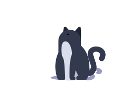

<!--
  ╔══════════════════════════════════════════════════════════╗
  ║              GREY SKY // DIGITAL ARCHIVE                 ║
  ║                    PROFILE README V2                     ║
  ╚══════════════════════════════════════════════════════════╝

  IMPORTANT:
  Replace YOUR_GITHUB_USERNAME with your actual GitHub username.
-->

<!-- ===================== HERO ===================== -->

<div align="center">

  

  <br>

  

  <h1>Mohammad M. Bakhshian</h1>

  <p>
    <code>SOFTWARE ENGINEERING STUDENT</code>
    <br>
    <sub>Building ideas. Breaking limits. Rebuilding better.</sub>
  </p>

  

  <br><br>

  
  
  

  <br><br>

  <a href="#identity">
    
  </a>
  <a href="#arsenal">
    
  </a>
  <a href="#telemetry">
    
  </a>
  <a href="#transmission">
    
  </a>

</div>

<br>

<!-- ===================== IDENTITY ===================== -->

<h2 align="center" id="identity">01 // IDENTITY PROTOCOL</h2>

<div align="center">

```text
┌────────────────────────────────────────────────────────────┐
│                                                            │
│   SUBJECT       : MOHAMMAD M. BAKHSHIAN                     │
│   CODENAME      : GREY SKY                                  │
│   JAPANESE      : 灰色の空                                  │
│   CLASS         : SOFTWARE ENGINEERING STUDENT              │
│   LOCATION      : TEHRAN, IRAN                              │
│                                                            │
│   PRIMARY MODE  : BUILD / EXPLORE / IMPROVE                 │
│   INTERESTS     : SOFTWARE / SYSTEMS / CREATIVE TECH        │
│                                                            │
│   DIRECTIVE     : TURN CURIOSITY INTO SOMETHING REAL        │
│                                                            │
└────────────────────────────────────────────────────────────┘
```

</div>

### `$ whoami`

I'm a software engineering student fascinated by the intersection of logic, creativity, and technology.

I enjoy exploring different areas of programming, understanding how systems work beneath the surface, and turning ideas into practical experiments.

My interests include software development, backend engineering, computer vision, embedded systems, mobile applications, and game development.

I don't believe in knowing everything.

I believe in staying curious enough to keep learning.

<br>

<div align="center">

  

  <p><i>"The most interesting things happen beyond the familiar."</i></p>

</div>

<details>
<summary><b>▸ OPEN THE BLACK BOX // MORE ABOUT ME</b></summary>

<br>

```bash
$ cat /system/manifest.txt

> Think deeply.
> Write clean code.
> Understand the architecture.
> Experiment without fear.
> Learn from every failure.
> Build something worth remembering.
```

**My development philosophy**

- Understand before implementing.
- Prefer meaningful projects over empty activity.
- Treat failure as feedback.
- Keep fundamentals stronger than frameworks.
- Stay curious about things outside my comfort zone.

</details>

---

<!-- ===================== ARSENAL ===================== -->

<h2 align="center" id="arsenal">02 // TECHNOLOGY ARSENAL</h2>

<div align="center">

  <sub>TOOLS DISCOVERED. LANGUAGES EXPLORED. IDEAS UNDER CONSTRUCTION.</sub>

  <br><br>

  <h3>⌗ PROGRAMMING LANGUAGES</h3>

  

  <br><br>

  <h3>⌗ DEVELOPMENT ECOSYSTEM</h3>

  

  <br><br>

  <h3>⌗ TOOLS & CREATIVE WORKSPACE</h3>

  

</div>

<br>

### `~/exploration-map`

| Domain | Technologies |
|:---|:---|
| Software Development | C++, C#, Python |
| Web Development | HTML, CSS, Django, WordPress |
| Mobile Development | Flutter, Dart |
| Computer Vision | OpenCV |
| Embedded Systems | Arduino |
| Game Development | Unity |
| Creative Tools | Figma, Git, Kali Linux |

<details>
<summary><b>▸ EXPAND // AREAS OF INTEREST</b></summary>

<br>

```text
[01] SOFTWARE ENGINEERING
     └── Architecture / Algorithms / Problem Solving

[02] COMPUTER VISION
     └── Image Processing / OpenCV / Visual Computing

[03] EMBEDDED SYSTEMS
     └── Arduino / Hardware Interaction

[04] APPLICATION DEVELOPMENT
     └── Django / Flutter / Cross-platform Applications

[05] GAME DEVELOPMENT
     └── Unity / Interactive Experiences
```

</details>

---

<!-- ===================== TELEMETRY ===================== -->

<h2 align="center" id="telemetry">03 // LIVE TELEMETRY</h2>

<div align="center">

  <sub>THE NUMBERS BEHIND THE CODE.</sub>

  <br><br>

  

  

  <br><br>

  

  <br><br>

  

</div>

<br>

<h3 align="center">⌗ ACTIVITY SIGNAL // LAST 31 DAYS</h3>

<div align="center">

  

</div>

---

<!-- ===================== 3D CONTRIBUTION ===================== -->

<h2 align="center">04 // CONTRIBUTION DIMENSION</h2>

<div align="center">

  <sub>A DIFFERENT PERSPECTIVE ON THE WORK BEHIND THE SCREEN.</sub>

  <br><br>

  

</div>

<br>

<h3 align="center">⌗ THE CONTRIBUTION SNAKE</h3>

<div align="center">

  <picture>
    <source media="(prefers-color-scheme: dark)"
            srcset="https://raw.githubusercontent.com/YOUR_GITHUB_USERNAME/YOUR_GITHUB_USERNAME/output/github-contribution-grid-snake-dark.svg" />
    <source media="(prefers-color-scheme: light)"
            srcset="https://raw.githubusercontent.com/YOUR_GITHUB_USERNAME/YOUR_GITHUB_USERNAME/output/github-contribution-grid-snake.svg" />
    
  </picture>

</div>

---

<!-- ===================== TRANSMISSION ===================== -->

<h2 align="center" id="transmission">05 // ESTABLISH CONNECTION</h2>

<div align="center">

  <sub>EVERY GREAT IDEA STARTS WITH A CONNECTION.</sub>

  <br><br>

  <a href="mailto:bakhshianmohammadmahdi@gmail.com">
    
  </a>

  <a href="https://www.linkedin.com/in/mohammad-m-bakhshian-128861398/">
    
  </a>

  <a href="https://www.instagram.com/bakhshianmohammadmahdi/?hl=en">
    
  </a>

  <br><br>

  <a href="https://github.com/YOUR_GITHUB_USERNAME">
    
  </a>

</div>

---

<!-- ===================== HIDDEN MESSAGE ===================== -->

<details>
<summary align="center"><b>▸ CLASSIFIED // ONLY FOR THE CURIOUS</b></summary>

<br>

<div align="center">

```text
╔══════════════════════════════════════════════════════╗
║                                                      ║
║                 TRANSMISSION FOUND                   ║
║                                                      ║
║         You made it to the end of the archive.       ║
║                                                      ║
║              Thanks for exploring.                   ║
║                                                      ║
║          There is always more to discover.           ║
║                                                      ║
╚══════════════════════════════════════════════════════╝
```

</div>

</details>

<div align="center">

  <br>

  

  <br><br>

  <h3><code>灰色の空</code></h3>

  <sub>DESIGNED WITH CURIOSITY. POWERED BY COFFEE. WRITTEN IN CODE.</sub>

  <br><br>

  

  <br><br>

</div>


<!--
  ╔══════════════════════════════════════════════════════════╗
  ║              GREY SKY // DIGITAL ARCHIVE                 ║
  ║                    PROFILE README V2                     ║
  ╚══════════════════════════════════════════════════════════╝

  IMPORTANT:
  Replace YOUR_GITHUB_USERNAME with your actual GitHub username.
-->

<!-- ===================== HERO ===================== -->

<div align="center">

  

  <br>

  

  <h1>Mohammad M. Bakhshian</h1>

  <p>
    <code>SOFTWARE ENGINEERING STUDENT</code>
    <br>
    <sub>Building ideas. Breaking limits. Rebuilding better.</sub>
  </p>

  

  <br><br>

  
  
  

  <br><br>

  <a href="#identity">
    
  </a>
  <a href="#arsenal">
    
  </a>
  <a href="#telemetry">
    
  </a>
  <a href="#transmission">
    
  </a>

</div>

<br>

<!-- ===================== IDENTITY ===================== -->

<h2 align="center" id="identity">01 // IDENTITY PROTOCOL</h2>

<div align="center">

```text
┌────────────────────────────────────────────────────────────┐
│                                                            │
│   SUBJECT       : MOHAMMAD M. BAKHSHIAN                     │
│   CODENAME      : GREY SKY                                  │
│   JAPANESE      : 灰色の空                                  │
│   CLASS         : SOFTWARE ENGINEERING STUDENT              │
│   LOCATION      : TEHRAN, IRAN                              │
│                                                            │
│   PRIMARY MODE  : BUILD / EXPLORE / IMPROVE                 │
│   INTERESTS     : SOFTWARE / SYSTEMS / CREATIVE TECH        │
│                                                            │
│   DIRECTIVE     : TURN CURIOSITY INTO SOMETHING REAL        │
│                                                            │
└────────────────────────────────────────────────────────────┘
```

</div>

### `$ whoami`

I'm a software engineering student fascinated by the intersection of logic, creativity, and technology.

I enjoy exploring different areas of programming, understanding how systems work beneath the surface, and turning ideas into practical experiments.

My interests include software development, backend engineering, computer vision, embedded systems, mobile applications, and game development.

I don't believe in knowing everything.

I believe in staying curious enough to keep learning.

<br>

<div align="center">

  

  <p><i>"The most interesting things happen beyond the familiar."</i></p>

</div>

<details>
<summary><b>▸ OPEN THE BLACK BOX // MORE ABOUT ME</b></summary>

<br>

```bash
$ cat /system/manifest.txt

> Think deeply.
> Write clean code.
> Understand the architecture.
> Experiment without fear.
> Learn from every failure.
> Build something worth remembering.
```

**My development philosophy**

- Understand before implementing.
- Prefer meaningful projects over empty activity.
- Treat failure as feedback.
- Keep fundamentals stronger than frameworks.
- Stay curious about things outside my comfort zone.

</details>

---

<!-- ===================== ARSENAL ===================== -->

<h2 align="center" id="arsenal">02 // TECHNOLOGY ARSENAL</h2>

<div align="center">

  <sub>TOOLS DISCOVERED. LANGUAGES EXPLORED. IDEAS UNDER CONSTRUCTION.</sub>

  <br><br>

  <h3>⌗ PROGRAMMING LANGUAGES</h3>

  

  <br><br>

  <h3>⌗ DEVELOPMENT ECOSYSTEM</h3>

  

  <br><br>

  <h3>⌗ TOOLS & CREATIVE WORKSPACE</h3>

  

</div>

<br>

### `~/exploration-map`

| Domain | Technologies |
|:---|:---|
| Software Development | C++, C#, Python |
| Web Development | HTML, CSS, Django, WordPress |
| Mobile Development | Flutter, Dart |
| Computer Vision | OpenCV |
| Embedded Systems | Arduino |
| Game Development | Unity |
| Creative Tools | Figma, Git, Kali Linux |

<details>
<summary><b>▸ EXPAND // AREAS OF INTEREST</b></summary>

<br>

```text
[01] SOFTWARE ENGINEERING
     └── Architecture / Algorithms / Problem Solving

[02] COMPUTER VISION
     └── Image Processing / OpenCV / Visual Computing

[03] EMBEDDED SYSTEMS
     └── Arduino / Hardware Interaction

[04] APPLICATION DEVELOPMENT
     └── Django / Flutter / Cross-platform Applications

[05] GAME DEVELOPMENT
     └── Unity / Interactive Experiences
```

</details>

---

<!-- ===================== TELEMETRY ===================== -->

<h2 align="center" id="telemetry">03 // LIVE TELEMETRY</h2>

<div align="center">

  <sub>THE NUMBERS BEHIND THE CODE.</sub>

  <br><br>

  

  

  <br><br>

  

  <br><br>

  

</div>

<br>

<h3 align="center">⌗ ACTIVITY SIGNAL // LAST 31 DAYS</h3>

<div align="center">

  

</div>

---

<!-- ===================== 3D CONTRIBUTION ===================== -->

<h2 align="center">04 // CONTRIBUTION DIMENSION</h2>

<div align="center">

  <sub>A DIFFERENT PERSPECTIVE ON THE WORK BEHIND THE SCREEN.</sub>

  <br><br>

  

</div>

<br>

<h3 align="center">⌗ THE CONTRIBUTION SNAKE</h3>

<div align="center">

  <picture>
    <source media="(prefers-color-scheme: dark)"
            srcset="https://raw.githubusercontent.com/YOUR_GITHUB_USERNAME/YOUR_GITHUB_USERNAME/output/github-contribution-grid-snake-dark.svg" />
    <source media="(prefers-color-scheme: light)"
            srcset="https://raw.githubusercontent.com/YOUR_GITHUB_USERNAME/YOUR_GITHUB_USERNAME/output/github-contribution-grid-snake.svg" />
    
  </picture>

</div>

---

<!-- ===================== TRANSMISSION ===================== -->

<h2 align="center" id="transmission">05 // ESTABLISH CONNECTION</h2>

<div align="center">

  <sub>EVERY GREAT IDEA STARTS WITH A CONNECTION.</sub>

  <br><br>

  <a href="mailto:bakhshianmohammadmahdi@gmail.com">
    
  </a>

  <a href="https://www.linkedin.com/in/mohammad-m-bakhshian-128861398/">
    
  </a>

  <a href="https://www.instagram.com/bakhshianmohammadmahdi/?hl=en">
    
  </a>

  <br><br>

  <a href="https://github.com/YOUR_GITHUB_USERNAME">
    
  </a>

</div>

---

<!-- ===================== HIDDEN MESSAGE ===================== -->

<details>
<summary align="center"><b>▸ CLASSIFIED // ONLY FOR THE CURIOUS</b></summary>

<br>

<div align="center">

```text
╔══════════════════════════════════════════════════════╗
║                                                      ║
║                 TRANSMISSION FOUND                   ║
║                                                      ║
║         You made it to the end of the archive.       ║
║                                                      ║
║              Thanks for exploring.                   ║
║                                                      ║
║          There is always more to discover.           ║
║                                                      ║
╚══════════════════════════════════════════════════════╝
```

</div>

</details>

<div align="center">

  <br>

  

  <br><br>

  <h3><code>灰色の空</code></h3>

  <sub>DESIGNED WITH CURIOSITY. POWERED BY COFFEE. WRITTEN IN CODE.</sub>

  <br><br>

  

  <br><br>

</div>


